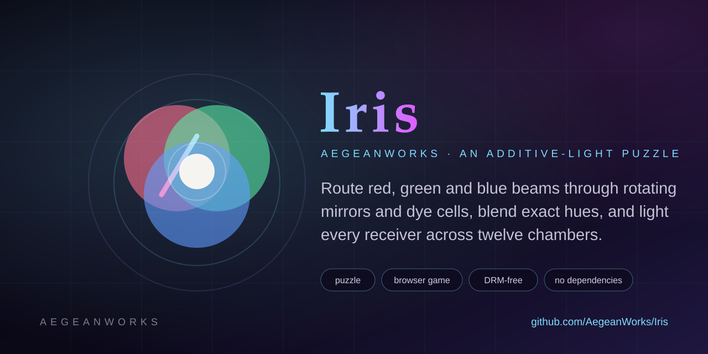

# Iris

<!-- aegean:media:start -->
<p align="center"></p>
<!-- aegean:media:end -->

[](https://github.com/AegeanWorks/AIKit)

A neon color-mixing puzzle: route red, green and blue beams through rotating mirrors and dye cells, blend exact hues, and light every receiver across three episodes.

## What it is

Iris is a zero-install browser puzzle about additive light. Each chamber gives you emitters, mirrors and dyes; every receiver wants one exact hue, and a beam that arrives too rich or too poor does not count. Rotate the mirrors, bend the light, and charge all receivers to finish the chamber.

- **Three episodes, twelve chambers**: primary routing, secondary mixing, then full-spectrum routes with white light.
- **Par and stars**: finish at or under par for three stars, within two extra moves for two.
- **Hints that cost nothing but time**: a dashed mirror shows one correct orientation for five seconds; the move still has to be made.
- **Keyboard and touch parity**: click or tap a mirror, or move with the arrow keys and rotate with Enter or Space.
- **Versioned local progress**: stars, best moves and the sound preference live in `localStorage` under `iris.progress.v1`; a corrupt or future record resets instead of breaking.
- **Generated audio only**: cues are synthesized with the Web Audio API; the repository ships no audio files and makes no network call.

## ⚡ 30-Second Cold-Start Quick Reference

- **Runtime Prerequisites**: Node.js 20 or newer for the local server, tests and tooling. Playing the game needs only a modern browser with ES modules; no package install, no build step and no backend.
- **Canonical Regression Shield Gate**:
  ```bash
  node --test tests
  ```

## Play locally

```bash
node scripts/serve.mjs --open
```

`play.cmd` (Windows) and `play.sh` (macOS/Linux) do the same. The server binds `127.0.0.1:4176`, serves only `index.html`, `src/` and `assets/`, refuses traversal, and sends `no-store` and `nosniff`. Opening `index.html` from disk does not work because the game is an ES module.

Deep links used by the website and by reviewers:

| URL | Shows |
|---|---|
| `?screen=chambers` | Chamber index with unlock state |
| `?level=<id>` | One chamber without saving progress, for review and QA |
| `?level=<id>&preview=victory` | Victory dialog without saving progress |
| `?screen=title&preview=howto` | Title screen with the help dialog open |

## How a chamber works

| Symbol | Meaning |
|---|---|
| Circle with an arrow | Emitter: a fixed color and direction |
| Slanted line | Mirror: rotates a quarter turn per click |
| Ringed circle | Dye cell: adds its primary color to the beam |
| Double ring | Receiver: charged only by its exact target hue |

Color is a bit mask: red `1`, green `2`, blue `4`. Yellow is red + green, cyan is green + blue, magenta is red + blue, and white is all three. A beam keeps its color until a dye cell adds another primary, and a receiver that gets red alone will not accept yellow.

## Verification

```bash
node --test tests                 # 73 engine, level, progress, server and UI contract tests
node scripts/check-levels.mjs     # every chamber's par equals the solver minimum
node scripts/dogfood.mjs          # headless Edge/Chrome: campaign start, solve, focus, arrows, hint, preview, responsive board
node scripts/ui-inventory.mjs     # every data-ui, data-panel and data-cue hook
```

`check-levels` brute-forces every mirror orientation (at most 256 routes on the largest chamber), proves the stored solution wins, and proves the advertised par is the true minimum. A level edit that breaks par fails the test suite.

## 📦 What's Inside

```text
iris/
├── index.html              <- the only page: title, chambers, game, dialogs
├── src/
│   ├── theme.css           <- the only file with raw colors and fonts
│   ├── styles.css          <- layout, board, dialogs and responsive rules
│   ├── game/
│   │   ├── engine.js       <- color masks, mirrors, tracing, frozen level validation
│   │   ├── levels.js       <- three episodes and twelve authored chambers
│   │   └── solver.js       <- exhaustive minimum-route search
│   └── ui/
│       ├── app.js          <- screens, board rendering, input, dialogs
│       ├── audio.js        <- generated Web Audio cues
│       └── progress.js     <- versioned localStorage record
├── assets/                 <- favicon, logo and social preview; no audio files
├── package.json            <- name, version, test and tooling scripts
├── play.cmd                <- Windows launcher for the local server
├── play.sh                 <- macOS/Linux launcher for the local server
├── scripts/                <- local server, level checker, UI inventory, dogfood
├── tests/                  <- node:test suites
├── PLAYABLE.md             <- the static contract the website build must keep
├── ASSETS.md               <- asset inventory and license coverage
├── LICENSE                 <- Aegean Game License 1.1 (AGL-1.1)
├── COMMERCIAL.md           <- commercial licensing terms
├── LICENSES/               <- REUSE license texts
├── REUSE.toml              <- machine-readable SPDX metadata
├── README.md
├── .gitignore              <- transient AIKit state excluded
└── .aikit/                 <- this project's memory: record, ledger, decisions
```

## Website contract

Iris is built to be copied into the AegeanWorks Live catalog under `docs/live/iris/<commit>/`. `PLAYABLE.md` lists the rules that keep that copy working: relative URLs only, all runtime files inside `index.html`, `src/` and `assets/`, no network calls, no service worker, no top-window navigation, and a semver `package.json` version.

## Live on AegeanWorks

Iris runs on the [AegeanWorks Live page](https://aegeanworks.github.io/AegeanWorks/play.html) as the **Iris** card. The website copies the commit-named build into `docs/live/iris/<commit>/`, shows its version, commit and digest, and checks it out in the daily `live.yml` workflow.

To ship an update, commit and push to this repository; the daily workflow refreshes the website build from the new `HEAD`. To refresh immediately in an AegeanWorks checkout:

```bash
python tools/sync_live_apps.py --source-root .. --check-source
python tools/sync_live_apps.py --source-root .. --write
python tools/sync_live_apps.py --check
```

The website side already lists Iris in `APPS`, the `play.html` no-script fallback and its live tests; `PLAYABLE.md` is the static contract those checks enforce.

<!-- aegean:brand-assets:start -->
## 🎨 Brand Assets

> **AI-Generated Brand Artwork.** The banner and logo are **AI-generated brand assets**. They are illustrative and may not literally depict every feature or the full project scope.
<!-- aegean:brand-assets:end -->

## 📜 License

Free for personal play under the Aegean Game License 1.1 (AGL-1.1); see [LICENSE](LICENSE). It is DRM-free: Licensor ships no DRM and a distributor may not add it. Streaming, modding and free mods are allowed. Commercial use, paid mods and AI training need the Aegean Commercial License 1.0 (ACL-1.0); see [COMMERCIAL.md](COMMERCIAL.md).
